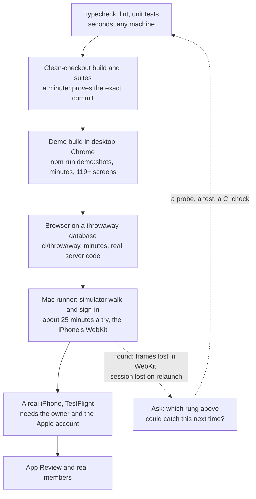
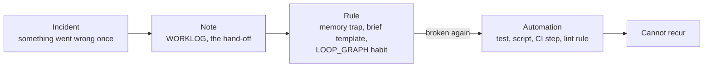
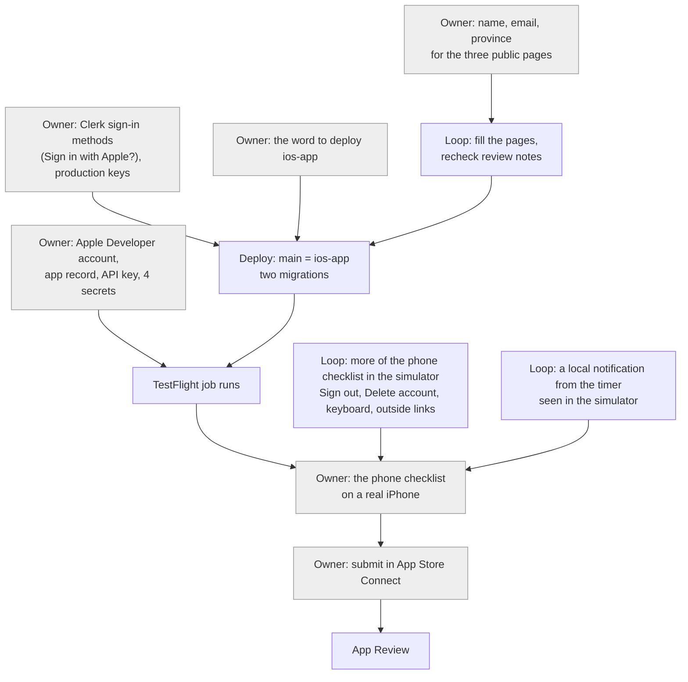

# The loop graph: how this project is built with AI

Written 2026-11-19, after the second iPhone loop. `docs/LOOP_HANDOFF.md` says
where things stand and what to do next; this page says **how a loop runs and
how it gets better each time**. A new loop reads both. The graphs are Mermaid
(GitHub draws them; any Mermaid viewer does).

## What good programmers do with AI loops, and what that means here

The owner asked for loops that improve themselves, drawn as graphs. These are
the habits that make that work, each with where it lives in this project.

1. **Every step has an oracle that is not the model's word.** A coder's "done"
   is a claim; a test, a typecheck, a screenshot or a CI run is evidence. Here:
   both suites, lint, the clean-checkout build, the browser on a throwaway
   database, and the Mac's pictures. Each round of both loops so far, looking
   found something the tests had not.
2. **Run the cheapest check first, and push checks down the ladder.** A fault
   found on the Mac costs 25 minutes a try; the same fault caught by a unit test
   costs seconds. When a slow oracle finds something, the follow-up question is
   "which faster oracle could have caught it?" (graph 2).
3. **The ratchet: nothing found twice.** A bug found by hand becomes a test, a
   CI step, a line in a brief or a trap in memory, so the next loop cannot
   repeat it. Gates only move forward (`docs/IOS_APP_STORE.md`).
4. **Improve the process, not only the product.** At the end of a loop, each
   lesson is promoted one rung: an incident becomes a rule (memory, the brief
   template), a rule that is broken twice becomes automation (a script, a CI
   check). That promotion is what makes the loop self-improving (graph 3).
5. **Plan work as a graph, not a list.** Goals have dependencies; coders can
   run together only when their files do not overlap. A goal graph shows both
   at once (graph 4). The loop itself is a state machine (graph 1), so a cold
   start knows which state it is in.
6. **Diagnose by experiment.** When the cause is unknown and the oracle is slow,
   ask several questions in one run: probes that each change one thing (the
   frame probe of 2026-11-14 settled in one Mac run what reading CSS could not).
7. **Small blast radius.** One worktree, each coder confined to named files and
   no git, commits by explicit path, the exact commit verified in a second clean
   checkout before a push, and never a deploy or a merge to `main` without the
   owner's word.
8. **The human decides at decision points only.** What needs the owner is parked
   and listed, and the loop moves to the next goal it can reach.
9. **Context is a resource.** Each loop ends by writing what a cold start needs
   (hand-off, gates, worklog, plan, memory); a long chat is condensed or
   replaced, never relied on.
10. **Measure the loop.** Per loop: goals done, coder jobs, rounds per goal,
    and where each defect was caught (graph 3's table). A rising share caught by
    fast oracles means the ratchet is working.

## Graph 1: the loop as a state machine

```mermaid
stateDiagram-v2
    [*] --> Orient: new chat, model set
    Orient: Orient\nread LOOP_HANDOFF, LOOP_GRAPH, memory\ngit status, git log, ListAgents
    Orient --> Plan
    Plan: Plan\ngoal graph: dependencies, file ownership\npick 2-4 goals that can run together
    Plan --> Brief
    Brief: Brief coders\nOpus = hard or risky, Sonnet = simple\nfiles allowed, no git, checks required
    Brief --> Build
    Build: Coders build\n(in parallel, one worktree)
    Build --> Review: coder reports
    Review: Director reviews\nread every line of the diff
    Review --> Brief: wrong approach
    Review --> Verify: diff is sound
    Verify: Run the oracle ladder\nfast to slow (graph 2)
    Verify --> Fix: something fails
    Fix: Fix\nsmall: director; large: back to a coder
    Fix --> Verify
    Verify --> Commit: all oracles pass
    Commit: Commit by path\nverify the exact commit in a clean checkout\npush ios-app when the Mac must see it
    Commit --> Learn
    Learn: Learn\npromote each lesson one rung (graph 3)
    Learn --> Plan: reachable goals left
    Plan --> Park: goal needs the owner
    Park: Park\nlist it, move on
    Park --> Plan
    Learn --> Handoff: end condition met,\nor nothing reachable
    Handoff: Write the hand-off\nLOOP_HANDOFF, gates, WORKLOG, PLAN, memory
    Handoff --> [*]: condense context or new chat
```

## Graph 2: the oracle ladder (cheap and fast at the top)

What each rung cannot see: Chrome is not WebKit (the frames bug is invisible
below rung E); a local WebKit is blocked on this machine by Application
Control; the simulator has no real Keychain signing, no push, no real
network; only rung F shows haptics, the keyboard, notifications and a signed
Keychain.

## Graph 3: how a lesson climbs (the self-improvement)

Lessons from the two iPhone loops and the rung each has reached:

| Lesson | Caught by | Rung now |
| --- | --- | --- |
| A Capacitor plugin object never settles when awaited | browser (rung D) | test with a Proxy stand-in (`native/notify.test.ts`) |
| Mileage's bars were all 4 px | demo pictures (rung C) | fixed; no visual check yet (candidate: a test on the bar heights) |
| Today's two cards lose their frames in WebKit | Mac walk (rung E) | fixed with `contain: paint` on the scene window, chosen by two probe rounds (one Mac run each); the walk checks it on every push |
| The session is lost on relaunch in the simulator | Mac sign-in (rung E) | fixed: the sign-in job signs the simulator build to run locally (an unsigned build gets no Keychain); the flow checks the relaunch on every push |
| The native slider thumb was a white pill in WebKit | Mac walk (rung E) | fixed: every slider drawn by one style (`index.css`, `lib/rangeFill.ts`, tested) |
| Vercel built every pushed branch; the evidence branches failed | the owner, in Vercel | config: `client/vercel.json` and a `vercel.json` on each evidence branch turn those deployments off |
| A coder's "done" was wrong | director review | rule: read every diff, look every time |
| Maestro's driver died during the sheet-to-app switch after the sign-in had worked (twice) | Mac sign-in (rung E) | automation: the check is two flows; `run.sh` goes on from the signed-in app when the server shows the code was traded, and says so in the summary |
| The workflow file was refused, zero jobs ran | GitHub, after a push | automation: `ci/workflow-check` (`npm ci && npm run check`) parses every workflow and flags the runner context in a job's env; it reports the refused file of 2026-11-14 |
| Polling the GitHub API ran down the 60-an-hour limit | the API | rule: wait on `git ls-remote` of the evidence branch |
| The computer slept mid-run | a stalled test | rule: ask the app to keep the machine awake for long waits |
| Coders' half-done edits in the shared folder broke a build | the suite | rule: verify the exact commit in a clean checkout before pushing |

## Graph 4: the next loop's goals

Redrawn 2026-11-20, after the third loop. Arrows mean "needs". Everything the
loops could reach without the owner for the App Store is done (G1, G2, G3, G6
of the previous graph); what is left is mostly the owner's (grey), and what
the loop can still add is more of the phone checklist proven in the simulator.

L1 and L2 touch different files (the Maestro flow and a new flow or step) and
can run at the same time. The loop's part of P starts the moment the owner
sends the three details.

## How to start a loop from this page

1. Read `docs/LOOP_HANDOFF.md`, this page, and the memory notes.
2. Find yourself in graph 1 (a new loop is at Orient).
3. Take the goals in graph 4 that nothing blocks, brief coders for the ones
   whose files do not overlap, and keep going round.
4. At the end, add this loop's lessons to graph 3's table with their rung, and
   redraw graph 4 for the next loop.
